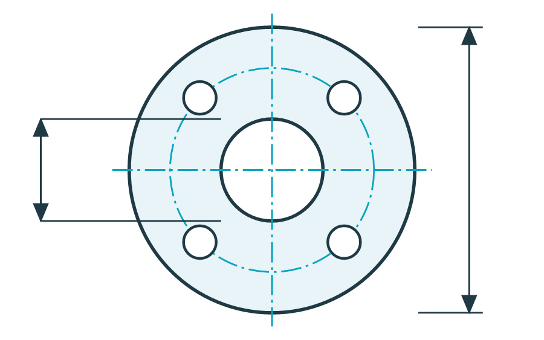

# Bilder {{ anchor('kap_bilder', uuid='0f027659-e82c-4227-af19-090f0da3ab86') }} {{ uuid('c4222003-8c40-442b-929c-7ec5df4b9c90') }}

Bilder stehen mit `image()` auf einer eigenen Zeile, ihr Pfad relativ zur Kapiteldatei. PNG und JPG werden eingebettet, SVG als Vektorgrafik mit einem PNG als Ersatz für Programme ohne SVG. Ein Bild ist nie breiter als die Textspalte von 16 cm. Das Bild über diesem Kapitel setzt das Manifest mit `chapter(…, image=…)`, das Titelbild mit `cover(…, image=…)`. {{ uuid('3801f0d4-0a55-4ec6-87e2-4b05e3644a37') }}

## Bild mit Bildunterschrift {{ uuid('16913343-9bb3-44b7-ab49-bc697646b8d3') }}

Ein `title` gibt dem Bild eine nummerierte Bildunterschrift, die das Abbildungsverzeichnis aufführt; `anchor` macht es zum Ziel eines Verweises: {{ ref('abb_workflow', uuid='d847d5cc-bdbd-4d2e-b23a-1fd973a2062d') }} steht auf Seite {{ ref('abb_workflow', 'page', uuid='ef2acc1a-e23d-40a6-8698-29ece20004b7') }}. Der `alt_text` ist der Alternativtext für Screenreader. {{ uuid('4a9913d0-dcf4-4298-83c0-cf8bf693f8d6') }}

{{ image('images/workflow.svg', width='14cm', title='Vom Manuskript über Markdown und Word zum PDF', anchor='abb_workflow', alt_text='Vier Dokumente mit Pfeilen: Manuskript, Markdown, Word, PDF', uuid='fae413b6-7a3d-44b9-8a3d-857164259422') }}


```markdown
{{ image('images/workflow.svg', width='14cm', title='Vom Manuskript über Markdown und Word zum PDF',
         anchor='abb_workflow', alt_text='Vier Dokumente mit Pfeilen: Manuskript, Markdown, Word, PDF') }}
{{ ref('abb_workflow') }} steht auf Seite {{ ref('abb_workflow', 'page') }}.
```


## Grösse {{ uuid('bb867cc3-3839-4a93-a705-4077757e4dce') }}

Die Breite `width` in cm, mm, pt oder Prozent der Textspalte; die Höhe folgt aus dem Seitenverhältnis. Mit `height` allein bestimmt die Höhe, mit beiden passt das Bild in den Rahmen, ohne verzerrt zu werden. `scale` bezieht sich auf die native Grösse der Datei (Pixel geteilt durch dpi): Das PNG des Flanschs hat 900 Pixel bei 300 dpi, also 7,6 cm. Bildschirmfotos verkleinern Sie nicht unter 84 %, sonst wird ihr Text zu klein; der Konverter warnt dann. {{ uuid('dbbb8a4d-328a-4352-8897-4354f85d2d04') }}

{{ image('images/bauteil.png', width='5cm', title='Breite 5 cm', uuid='7a15e313-3f9a-47e4-8df0-b874b87094d6') }}

{{ image('images/bauteil.png', width='50%', title='Breite 50 % der Textspalte', uuid='e15890a0-c537-4a06-a541-dd27be6ec396') }}

{{ image('images/bauteil.png', height='3cm', title='Höhe 3 cm', uuid='24130409-bffe-4ea6-b006-1a1ba7400482') }}

{{ image('images/bauteil.png', scale='90%', title='90 % der nativen Grösse', uuid='d74f6fbb-9ab8-4eee-a5cd-02407e7a894b') }}


```markdown
{{ image('images/bauteil.png', width='5cm', title='Breite 5 cm') }}
{{ image('images/bauteil.png', width='50%', title='Breite 50 % der Textspalte') }}
{{ image('images/bauteil.png', height='3cm', title='Höhe 3 cm') }}
{{ image('images/bauteil.png', scale='90%', title='90 % der nativen Grösse') }}
```


## Ausrichtung, Rahmen und Zuschnitt {{ uuid('c33d9807-4e57-4901-85dc-b9a5152bbc22') }}

Ohne `align` steht ein Bild in der Mitte; `'left'` und `'right'` setzen es an den Rand. `border=True` zeichnet eine graue Linie um das Bild. `crop` schneidet in Prozent ab, in der Reihenfolge oben, rechts, unten, links wie in CSS; Word schneidet zu, die Datei bleibt unverändert. {{ uuid('8d2ea3a7-8cce-4f14-b5a4-f022e6d8510c') }}

{{ image('images/bauteil.png', width='5cm', align='left', border=True, title='Links, mit Rahmen', uuid='46a7ab6a-191b-44e4-b61a-e4c68ff91435') }}

{{ image('images/bauteil.png', width='5cm', align='right', crop='0 25% 0 25%', title='Rechts, links und rechts je 25 % abgeschnitten', uuid='d7eeaaaf-fb17-4aaf-972c-46f5f463c124') }}


```markdown
{{ image('images/bauteil.png', width='5cm', align='left', border=True, title='Links, mit Rahmen') }}
{{ image('images/bauteil.png', width='5cm', align='right', crop='0 25% 0 25%',
         title='Rechts, links und rechts je 25 % abgeschnitten') }}
```


## Umfliessender Text {{ uuid('d01d1782-d5ae-4f75-a935-8476cabcd5a9') }}

{{ image('images/bauteil.png', width='6cm', align='right', wrap=True, title='Flansch, Draufsicht', uuid='b0636a9f-f6a8-4e8f-bd54-6ca992df9abe') }}

Mit `wrap=True` steht das Bild mit seiner Bildunterschrift in einem Rahmen am Rand, der Text fliesst daneben vorbei. Das eignet sich für kleine Bilder neben einem längeren Absatz, etwa eine Zeichnung neben ihrer Beschreibung. Der Flansch in der Zeichnung hat vier Bohrungen auf einem Lochkreis; die strichpunktierten Linien sind Mittellinien, die Pfeile bemassen Aussendurchmesser und Lochkreis. In einer technischen Zeichnung stehen an diesen Massen Zahlen; hier bleibt die Zeichnung ohne Text, damit sie in jeder Sprache passt. {{ uuid('744812dd-492b-4bac-8f42-599c6b69bb92') }}

Ein umflossenes Bild steht links oder rechts, nie in der Mitte. Folgt kein Text, beginnt der nächste Block unter dem Bild. {{ uuid('e8d8d4be-71d3-474e-9688-a0592f7951bf') }}


```markdown
{{ image('images/bauteil.png', width='6cm', align='right', wrap=True, title='Flansch, Draufsicht') }}

Mit `wrap=True` steht das Bild …
```


## Bildunterschrift ohne Nummer und gedrehtes Bild {{ uuid('cf4750ef-3920-4069-8d76-47bc51f28e00') }}

Mit `numbered=False` steht nur der Titel unter dem Bild, ohne «Abbildung n:». `rotate` dreht das Bild um 90, 180 oder 270 Grad im Uhrzeigersinn, negativ dagegen; Breite und Zuschnitt gelten danach. So passt ein Diagramm im Querformat hochkant auf die Seite: {{ uuid('121f5a97-c54d-49a7-921b-04429f6d5386') }}

{{ image('images/diagramm.svg', width='7cm', rotate=-90, title='Monatswerte, um 90 Grad gedreht', numbered=False, uuid='127d5f40-6bcb-4dcc-bc58-6964492e01b1') }}


```markdown
{{ image('images/diagramm.svg', width='7cm', rotate=-90, title='Monatswerte, um 90 Grad gedreht', numbered=False) }}
```


## Markdown-Bild und Platzhalter {{ uuid('bbcfb663-8b9f-41cb-9277-d255c9c5f25c') }}

Auch die Markdown-Schreibweise für Bilder funktioniert; der Text in eckigen Klammern wird der Alternativtext, ein Titel in Anführungszeichen die Bildunterschrift: {{ uuid('78de80b6-5da7-49cc-a394-494e66bbebe3') }}



Fehlt ein Bild noch, steht sein Dateiname in doppelten runden Klammern als Platzhalter: {{ uuid('9165afd8-8259-45ac-b8d6-205fbea59e5d') }}

((Foto_Druckmaschine.jpg))


```markdown

((Foto_Druckmaschine.jpg))
```


## QR-Code {{ uuid('00d01816-41e9-4951-bcf4-a87ab0165f65') }}

`qr_code()` erzeugt beim Rendern einen QR-Code; Grösse, Farbe und Ausrichtung sind wählbar. Ohne Text erscheint ein Warnzeichen, damit ein fehlender Code auffällt. {{ uuid('129d1abc-e68c-4b5a-b21e-8e53e3d340a8') }}

{{ qr_code('https://commonmark.org', uuid='228fd415-091f-46db-a2fa-411c57b6ff39') }}

{{ qr_code('https://spec.commonmark.org/0.31.2/', '2cm', '#03A4C0', 'center', uuid='18112119-2302-4692-acd5-c0b494156f7f') }}

{{ qr_code(size='2cm', alignment='right', uuid='55e993ef-4286-45c7-8ba1-245c15350fa6') }}


```markdown
{{ qr_code('https://commonmark.org') }}
{{ qr_code('https://spec.commonmark.org/0.31.2/', '2cm', '#03A4C0', 'center') }}
{{ qr_code(size='2cm', alignment='right') }}
```


## Rasterpapier {{ uuid('b65af3ac-1537-4983-a7fb-05bd6f6bcd82') }}

`grid()` zeichnet Häuschenpapier, etwa als Platz für eine Skizze oder eine Rechnung: ohne Argumente 32 × 47 Häuschen zu 5 mm, die eine ganze Seite füllen. {{ uuid('6aa2fa3f-9d09-4022-a55c-3406fa7f2514') }}

{{ grid(n_height=6, uuid='1131ee38-6943-4644-886f-aaf2e235b783') }}

{{ grid('4mm', 20, 5, '0.2mm', '#03A4C0', 'center', uuid='86712346-9b62-4f62-a9a7-9302fb77e388') }}


```markdown
{{ grid(n_height=6) }}
{{ grid('4mm', 20, 5, '0.2mm', '#03A4C0', 'center') }}
```

